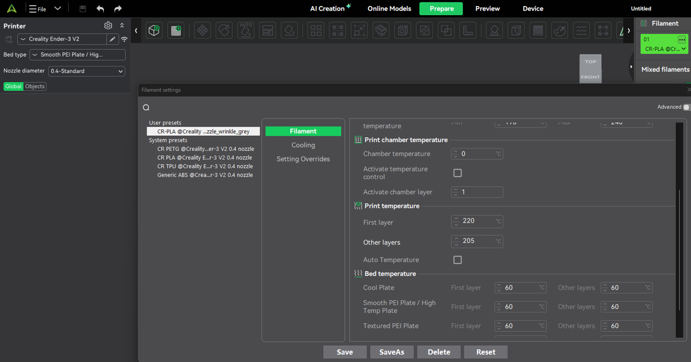
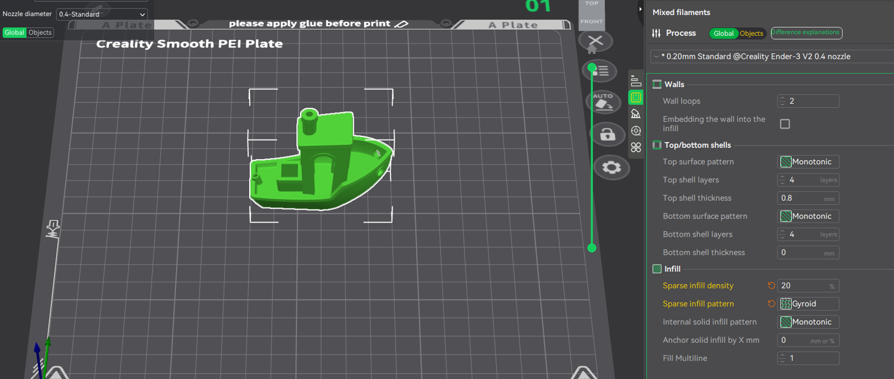

# Settings

## Filament
### PLA
* T_nozzel_first_layers = 220C
* T_nozzel_other_layers = 205C

* sparse_infill_pattern = gyroid
* sparse_infill_density = 20%

# Sources
**Recommandation**: use gemini notebook LLM by loading documentation of the 3d printer as source.\
Then, send picture of problem and do iteration to solve.

## specific to the machine
* [web page](https://www.creality.com/products/ender-3-v2-3d-printer-csco)
* [beginer](https://www.youtube.com/watch?v=b2Od4YHcLAQ)
* [cura x creality-3 V2](https://www.youtube.com/watch?v=e-lQPGJ3Psc)

* [installation](https://www.youtube.com/watch?v=LV1Nnohwqik)
* [maintainance](https://www.youtube.com/watch?t=491&v=v8SwY8yveqc&feature=youtu.be)
* [bed level](https://www.youtube.com/watch?v=ypb1OUII9Nw)
* [upgrade](https://www.youtube.com/watch?v=v8SwY8yveqc&t=491s)
* [benctest boat](https://www.printables.com/model/597124-3dbenchy-boat-printer-test/files)

## general about 3d printing
* [start](https://www.youtube.com/watch?v=ENDCemxyA1o)
* [temp issue](https://www.youtube.com/watch?v=bkzEBcN-L6k)

## 3d printing model website
* [printable](https://www.printables.com/)
* [thingiverse](https://www.thingiverse.com/)
* [cult3d](https://cults3d.com/)

## operating code
[bed_level_and_cleaning_code](https://github.com/cr8ivecodesmith/ender3_v2_assisted_bed_leveling)

# other sources

Ender3 V2 Assisted Bed Leveling
================================

This is a GCode for the Ender3 V2 Marlin firmware to simplify the leveling
process.

It does the ff. steps:

- Sets nozzle and bed temperatures
- Sets the nozzle and bed for manual inspection and cleaning
- Does 3 cycles of bed leveling on 5 points
- Homes all axis and disables the stepper motors

Tested on Creality Ender3 V2 Stock Firmware V1.0.2

#### Other inclusions

- A medium (5x) and long (10x) calibration scripts.
- A bed leveling test stl file.
- A standalone bed and nozzle cleanup script.

#### Usage

- Run the `e3v2_bed_level_3x.gcode` before you print.
- If you just wish to clean the bed and nozzle, run the `e3v2_cleanup.gcode`.
- You can also generate a gcode of the `e3v2_bed_level_test.stl` to run a
  ~4min leveling test on all 5 points of the bed.

#### Known Issues

When a pause (M25) is triggered, you will need to move the cursor to see
the updated menu.

See: https://forums.creality3dofficial.com/community/postid/156/

#### Resources and References

- [CHEP Ender 3 Bed Level](https://www.chepclub.com/bed-level.html)
- [G-Code for Semi Automated Assisted Bed Leveling for 3d Printers by irvshapiro](https://www.thingiverse.com/thing:4023588)
- [Marlin Firmware GCode Documentation](https://marlinfw.org/meta/gcode/)
- [Ender 3 Pro Bed Level Test + Calibration Wizard by adamsiem](https://www.thingiverse.com/thing:4257692)
- [SainSmart How to Level Your Ender3 V2](https://docs.sainsmart.com/article/0bwiehyjlg-ender-3-v-2-bed-leveling)
